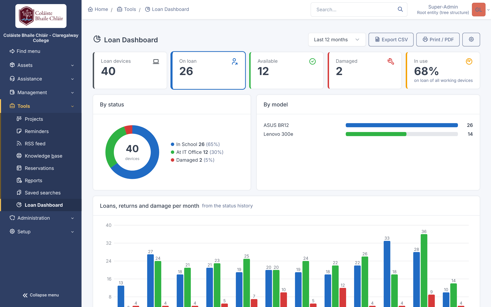
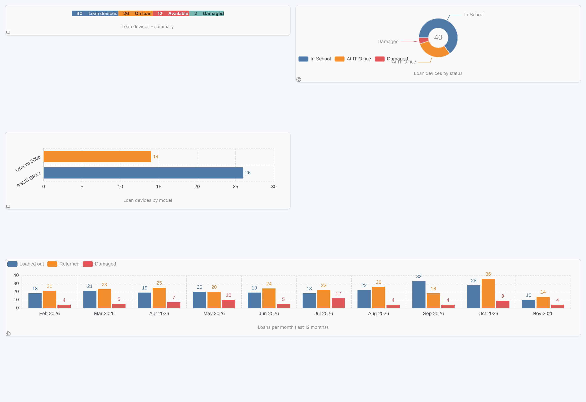
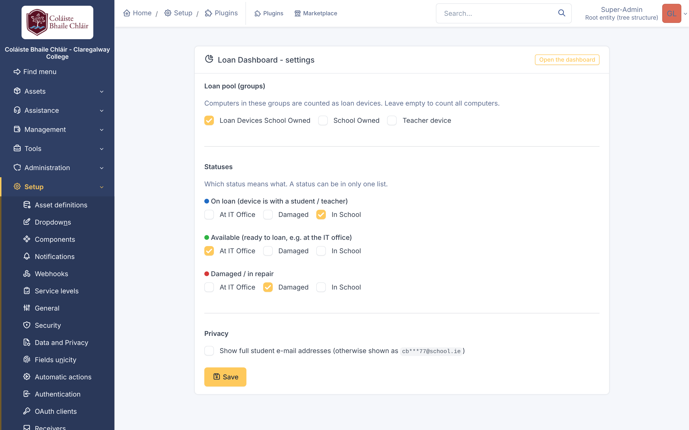

# GLPI Loan Dashboard

Dashboard and reports for **school loan devices** in GLPI: how many devices are on loan, available or damaged, charts by status and model, loans per month, the list of devices currently on loan and CSV export.

Tested on **GLPI 12.0.1** (works on GLPI 11.0+ / 12.x, PHP 8.2+).

**Download:** [`loandashboard-1.0.0.tar.gz`](https://github.com/ravxvx/glpi-loan-dashboard/raw/main/dist/loandashboard-1.0.0.tar.gz) – ready to upload in [GLPI Plugin Uploader](https://github.com/ravxvx/glpi-plugin-uploader) or to extract into the GLPI plugins folder.



## Features

- **Tools → Loan Dashboard** page:
  - tiles: loan devices, on loan, available, damaged, % in use
  - donut chart by status, bars by model
  - **loans, returns and damage per month** (last 3 / 6 / 12 / 24 months) – from GLPI's own status history
  - list of devices **on loan / available / damaged / all** with user, student e-mail (Fields plugin), location, status date and **days on loan** (orange after 30, red after 60 days)
  - most loaned devices
  - **Export CSV** (opens in Excel) and **Print / PDF**
- **Cards for GLPI's own dashboard** (Home → Dashboard → edit → **+** → group *Loan devices*): summary, on loan, available, by status, by model, loans per month



## Settings

**Setup → Plugins → Loan Dashboard** (wrench icon):

- **Loan pool:** the group(s) of loan computers (e.g. *Loan Devices School Owned*). Empty = all computers.
- **Statuses:** which status means *on loan*, *available* and *damaged*.
- **Privacy:** student e-mails are shown partly hidden (`cb***77@school.ie`) unless you allow full addresses.

On first install the plugin guesses the settings from the names (a group containing "loan"; statuses like *In School*, *At IT Office*, *Damaged*), so it usually works straight away.



## How it works

- No own tables – everything is read from GLPI: computers, groups (`glpi_groups_items`), statuses and the status history (`glpi_logs`).
- The monthly chart counts status changes: into an *on loan* status = loaned out, into *available* = returned, into *damaged* = damaged.
- Charts on the page are plain SVG – no external libraries, they also print.
- Only users who can view computers see the page; only Super-Admins can change the settings.

## Installation

Upload the archive with **GLPI Plugin Uploader**, then **Install** and **Enable** in **Setup → Plugins**. Or manually:

```bash
cd /var/www/glpi/marketplace        # or /var/www/glpi/plugins
tar xzf loandashboard-1.0.0.tar.gz
chown -R www-data:www-data loandashboard
```

Screenshots show sample data.

## License

GPLv2+
